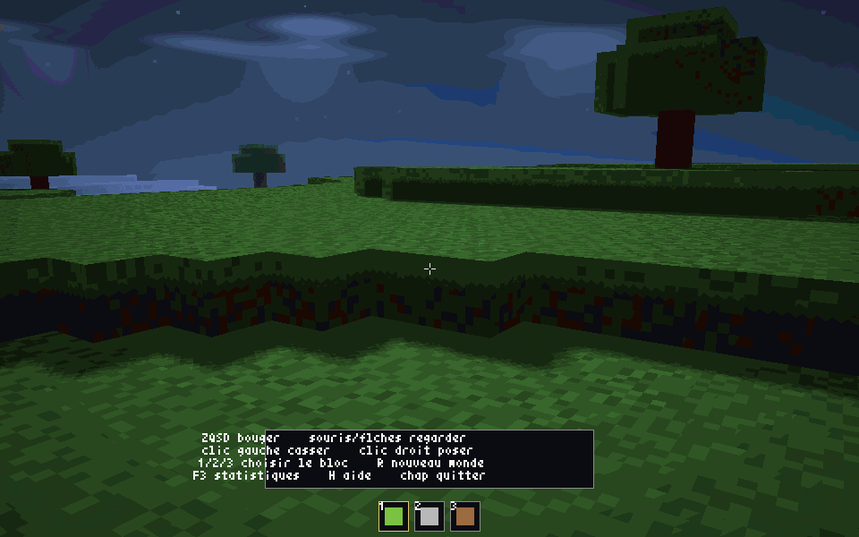

# PyCraft

Un monde de blocs en **vraie 3D**, en vue première personne, projet NSI.

Le rendu 3D est calculé par le **GPU** (OpenGL 4.1 via moderngl) : ombres portées,
eau animée, ciel dégradé, brouillard, cycle jour/nuit et pluie. Le résultat est
quantifié sur une palette de **256 couleurs** puis affiché par
[Pyxel](https://github.com/kitao/pyxel), qui gère la fenêtre, les entrées, le HUD
et le son. Un renderer **CPU** reste disponible en secours (`--cpu`).

On marche, on regarde autour de soi, on **casse** et on **pose** des blocs dans un
monde généré de 256×256 blocs.



## Installation

```bash
python3 -m venv .venv
.venv/bin/pip install -r requirements.txt -r requirements-dev.txt
```

## Lancer

```bash
.venv/bin/python main.py
.venv/bin/python main.py --res 1920x1200 --dist 120 --seed 42
```

## Commandes

| Touche | Action |
|---|---|
| ZQSD | se déplacer |
| Souris / flèches | regarder autour |
| Clic gauche | casser le bloc visé |
| Clic droit | poser le bloc actif |
| 1 / 2 / 3 | choisir herbe / pierre / bois |
| `R` | nouveau monde (graine + 1) |
| `H` | aide |
| `F3` | fps, quads, chunks, graine |
| `Échap` | quitter |

## Options

| Option | Défaut | Rôle |
|---|---|---|
| `--res LxH` | `1280x800` | résolution de la fenêtre (min 160x120, max 3840x2160) |
| `--dist N` | `96` | distance de vue en blocs |
| `--detail N` | `24` | rayon du maillage détaillé (LOD) |
| `--no-lod` | — | tout en maillage détaillé (plus joli, plus lent) |
| `--seed N` | `0` | graine du monde |
| `--cpu` | — | force le renderer CPU (sans OpenGL) |
| `--no-shadows` | — | désactive les ombres portées |
| `--weather` | — | active la pluie |

## Tests et benchmark

```bash
.venv/bin/python -m pytest -q              # tests sans GPU
.venv/bin/python -m pytest -q -m gpu      # tests OpenGL
.venv/bin/python tools/bench.py --renderer gpu --res 1280x800 --dist 96
```

Mesures sur Mac arm64 (monde 256×256×32, fenêtre réelle) :

| Renderer | Configuration | Frame moyenne | p95 | fps max |
|---|---|---|---|---|
| GPU | 1280×800, distance 96 | **3,71 ms** | 3,83 ms | 269 |
| GPU | 1920×1200, distance 120 | **5,62 ms** | 5,81 ms | 178 |
| CPU | 1280×800, distance 96 | 3,67 ms | 3,77 ms | 272 |

## Comment ça marche

Deux renderers partagent la même scène :

**GPU (par défaut)** — `pycraft/gl/` :

1. **six passes** : shadow map (ombres), ciel, terrain, eau, météo, post-traitement ;
2. la scène est rendue en RGB dans un framebuffer, puis convertie en **indices de
   palette** (LUT 32³) dans une texture R8 ;
3. `glReadPixels` lit 1 octet par pixel, recopié dans `pyxel.screen` ; Pyxel
   affiche la frame et dessine le HUD par-dessus.

**CPU (secours)** — l'ancien renderer, tout en Python :

1. **Monde** : un `bytearray` de 256×256×32, découpé en chunks de 16×16.
2. **Maillage** : chaque chunk garde la liste de ses faces visibles, en cache.
   Deux niveaux de détail : une face par bloc près de la caméra, faces
   fusionnées (*greedy meshing*) au loin.
3. **Projection** : chaque face est transformée dans l'espace caméra (numpy),
   découpée au plan proche, puis projetée à l'écran.
4. **Tri du peintre** : les faces sont dessinées de la plus lointaine à la plus
   proche, en `pyxel.tri`.

Détails, formules et choix de performance : [docs/technique.md](docs/technique.md).

## Structure

```
main.py          → point d'entrée (arguments, boucle Pyxel, entrées)
pycraft/
  gl/            → renderer GPU : contexte, palette, géométrie, shaders
  config.py      → constantes, palette, types de blocs
  world.py       → monde voxel (bytearray), génération, lacs, arbres
  mesher.py      → maillages détail + greedy, cache par chunk
  camera.py      → caméra, projection, clipping du plan proche
  renderer.py    → ciel, brouillard, tri et dessin
  player.py      → déplacement, collisions, raycast, casser/poser
  hud.py         → réticule, hotbar, aide, écran titre, stats
tests/           → 85 tests unitaires (sans fenêtre)
tools/bench.py   → benchmark reproductible
```

## Documents

- [SPEC.md](SPEC.md) — spécification approuvée
- [docs/technique.md](docs/technique.md) — comment la 3D est calculée
- [docs/intent/pycraft.md](docs/intent/pycraft.md) — intention du projet
- [docs/ideas/pycraft.md](docs/ideas/pycraft.md) — direction technique et mesures
- [tasks/plan.md](tasks/plan.md) · [tasks/todo.md](tasks/todo.md) — plan et suivi
